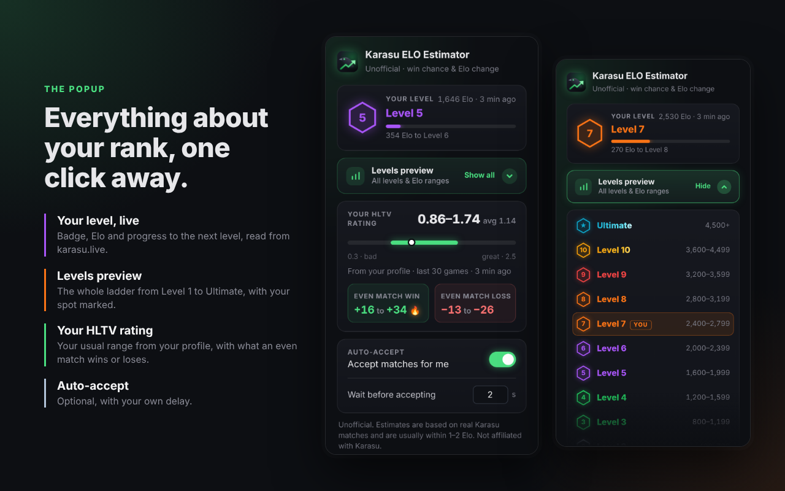
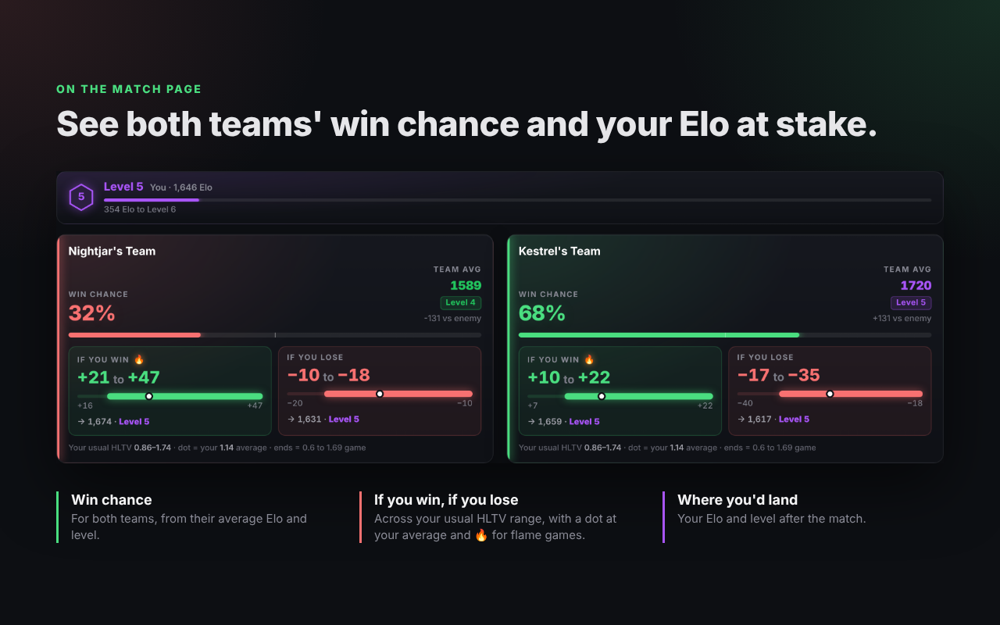

## Screenshots

<p align="center">
  
</p>

<p align="center">
  
</p>

# Karasu ELO Estimator

**Unofficial** Chrome extension for [karasu.live](https://karasu.live). It shows each team's win chance and your estimated Elo gain or loss on the match page. It can also accept matches for you if you turn that on.

> Not affiliated with, endorsed by, or made by Karasu.

## Features

- **Win chance** for both teams, from the teams' average Elo.
- **Estimated Elo gain and loss** at your usual HLTV rating, plus the range from a bad game (0.6 rating) to a great game (1.69 rating).
- **Shown on the Overview tab** of every match, before, during and after the game.
- **Premade parties marked**: players who queued together share a coloured link tag (A, B, C…) on the player chips and on Karasu's own player rows. This comes from the same lineup request the flags use, so it adds no API calls. Across 2,000 recent 5v5 matches the team with more premade players won about 50% of the time, so premades don't change the win chance.
- **Level outlook on player profiles**: from the last-30 HLTV rating and win rate, the average Elo per game and roughly how many games until the next level (or a level drop), plus the player's HLTV-form Elo.
- **Optional auto-accept** with an adjustable delay. It is off until you turn it on.

## How the estimate works

Karasu does not publish its Elo formula. This model was fitted across 25 real matches and is usually within 1–2 Elo.

```
chance = 1 / (1 + 10 ^ ((enemyAvg - teamAvg) / 400))      // standard Elo win chance
win    = 44 × (1 − chance) × (0.08 + 0.79 × rating)
loss   = 44 × chance       × (1.94 − 0.81 × rating)
```

`rating` is the player's HLTV rating in the match. A standout game (rating of 1.69 or more, the flame icon on Karasu) counts as a 2.00 rating for the win. Wins are capped at 40 (48 for a flame game) and losses at 40, and every change is at least 3.
Your own Elo does not change the result; only the two team averages and how you play do.

The model is in [`model.js`](model.js).

## Install

**From source (Chrome, Edge, Brave, Opera):**

1. Download this repository (**Code → Download ZIP**) and unzip it.
2. Open `chrome://extensions` and turn on **Developer mode**.
3. Click **Load unpacked** and choose the unzipped folder.
4. Click the extension's icon and set your usual HLTV rating.

## Files

| File | What it does |
|---|---|
| `manifest.json` | Extension setup and permissions |
| `model.js` | The Elo estimate formula |
| `content.js` | Reads both teams' Elo on the match page and draws the estimate cards |
| `accept.js` | Optional auto-accept |
| `popup.html`, `popup.js` | Settings popup |
| `icons/`, `assets/icon.svg` | Icons |

## Privacy

The extension collects no data and makes no network requests. It only runs on karasu.live and saves your settings in Chrome's own extension storage. See [PRIVACY.md](PRIVACY.md).

## Permissions

- `storage`: saves your settings.
- Access to `https://karasu.live/*`: reads the match page and shows the estimates there.

## License

[MIT](LICENSE)
